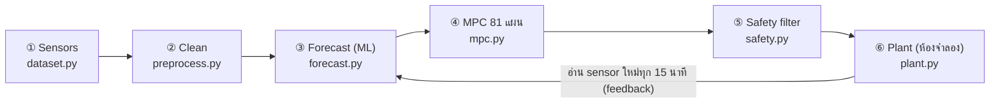

# Predictive Cooling Optimization for Data Centers

> **"ถ้าอีก 30 นาทีโหลดจะเพิ่มขึ้น เราควรปรับระบบทำความเย็นตั้งแต่ตอนนี้อย่างไร ให้แร็คไม่ร้อนเกินและใช้ไฟน้อยที่สุด?"**

เวอร์ชันนี้ออกแบบใหม่ทั้งหมดให้ตรงกับ proposal (ML ทำนาย + MPC เลือกแผน + Safety check + เทียบ baseline)
และ **ตัดส่วนที่ไม่จำเป็นออก**: ไม่มี LLM agent, LangGraph, Gemini, FastAPI, Supabase/auth หรือการติดตั้ง SustainDC อีกแล้ว
เหลือเป็น Python package เล็กๆ ไฟล์ละหนึ่งขั้นตอน + dataset mock ที่เปิดดูได้ + dashboard แท็บละหนึ่งขั้นตอน


## ภาพรวมใน 1 นาที



ทุก 15 นาที ระบบจะ

1. **อ่าน sensor**: อุณหภูมิ inlet ของ 12 แร็ค, มิเตอร์ไฟ IT/cooling, CRAH และอากาศภายนอก
2. **ทำความสะอาดข้อมูล**: เติมช่วงที่ขาด, ตัดค่าเพี้ยน, จับ sensor ค้าง
3. **ทำนาย 15/30/45/60 นาทีข้างหน้า**: ถ้าใช้ setpoint ชุดนี้ แร็คที่ร้อนที่สุดจะกี่ °C และกินไฟ cooling/IT เท่าไร
4. **MPC ลอง 81 แผน**: แต่ละ 15 นาทีเลือก ลด/คง/เพิ่ม 1 °C ได้ 4 ครั้ง (3⁴ = 81) แล้วตัดแผนที่คาดว่าจะร้อนเกิน 27 °C ออก จากนั้นเลือกแผนที่ใช้ไฟน้อยสุด แต่ใช้แค่ก้าวแรก
5. **Safety filter**: ตรวจคำสั่งก่อนส่ง ถ้า sensor หาย, สภาพแวดล้อมแปลกกว่าตอน train หรือร้อนใกล้ limit ก็จะ override ทันที
6. **Plant (ห้องจำลอง)**: เป็นตัวตัดสินผล ทุก controller เจอ workload, อากาศและ noise ชุดเดียวกันทั้งหมด

## Dataset mock: `data/sensor_history.csv`

ห้อง server จำลองขนาด 12 แร็ค (สองแถว หันหน้าเข้า cold aisle เดียวกัน, CRAH อยู่ผนังซ้าย) ช่วง 2 ก.พ. – 3 พ.ค. 2026
ทุก 15 นาที รวม **8,718 แถว × 25 sensor** (ขนาดประมาณ 1.6 MB เปิดด้วย Excel ได้)


| คอลัมน์ | หน่วย | ความหมาย |
|---|---|---|
| `outdoor_temp_c` | °C | อุณหภูมิอากาศภายนอก (ภูมิอากาศร้อนชื้นแบบกรุงเทพฯ, อุ่นขึ้นเรื่อยๆ ถึงเม.ย., มีพายุช่วงบ่าย) |
| `it_load_pct`, `it_power_kw` | %, kW | โหลด CPU/GPU เฉลี่ย และไฟฝั่ง server (รวมพัดลมใน server) |
| `inlet_A1_c` … `inlet_B6_c` | °C | อุณหภูมิลมเข้าหน้าแร็ค **ค่าที่ต้องไม่เกิน 27 °C** (ASHRAE) |
| `supply_air_c`, `return_air_c` | °C | ลมเย็นที่ CRAH จ่ายออก / ลมร้อนที่กลับเข้ามา |
| `crah_setpoint_c` | °C | **ปุ่มเดียวที่ AI ควบคุม**: setpoint ลมจ่าย (16–24 °C) |
| `crah_fan_pct` | % | ความเร็วพัดลม CRAH (อัตโนมัติตามโหลด) |
| `chiller_kw`, `crah_fan_kw`, `pump_tower_kw`, `cooling_kw` | kW | มิเตอร์ย่อยฝั่งทำความเย็น |
| `facility_kw`, `pue` | kW, – | ไฟทั้งอาคาร และ PUE = facility ÷ IT |

ข้อมูลนี้สร้างจากอะไร (`predictive_cooling/dataset.py`)

- **Workload**: โหลด office ช่วงกลางวัน, **งาน GPU training ทุกคืนวันธรรมดา 01:00–05:00** (แร็ค B4–B6), งาน report ตอนบ่าย และงานที่ไม่ได้นัดไว้แบบสุ่ม
- **Plant**: `plant.py` เป็นแบบจำลองฟิสิกส์อย่างง่าย มี recirculation ของลมร้อน (B6 ปลายแถวร้อนที่สุด), thermal lag ราว 25 นาที,
  COP ของ chiller ดีขึ้นประมาณ 4 %/°C เมื่อ setpoint สูงขึ้น และพัดลม server เร่งรอบเมื่อ inlet เกิน 26 °C (ไฟ IT จึงเพิ่ม)
- **Operator เดิม**: ใช้ rule ง่ายๆ คุมห้อง และ **ทำ step test ปรับ setpoint ขึ้นลงเป็นช่วงๆ** เพื่อให้ข้อมูลมี setpoint หลายระดับ
  (ถ้า setpoint ไม่เคยเปลี่ยนเลย โมเดลจะเรียนรู้ไม่ได้ว่า setpoint มีผลอย่างไร)
- **ใส่ปัญหาจริงลงไปด้วย**: ข้อมูลหาย 0.3 %, ค่า glitch 85/−40/0 °C, sensor A3 ค้าง 8 ชม. และ logger ดับ 2 ครั้ง (18 แถว)

สร้างใหม่ได้ด้วย `python -m predictive_cooling.dataset` (กำหนด seed ไว้ ผลจึงออกมาเหมือนเดิมทุกครั้ง)

## ขั้นตอนในโค้ด

| ขั้น | ไฟล์ | ทำอะไร |
|---|---|---|
| ① | `dataset.py` | สร้าง workload, อากาศ, ประวัติการคุมห้องและ fault ใน log |
| ② | `preprocess.py` | reindex ให้ครบทุก 15 นาที → ตัดค่าที่เป็นไปไม่ได้ → จับ sensor ค้าง (ค่าซ้ำ ≥ 6 ครั้ง) → เติมรูไม่เกิน 1 ชม. แล้วแบ่ง train (สัปดาห์ 1–9), validation (10–11), test (12–13) ตามลำดับเวลา |
| ③ | `forecast.py` | เทียบ 3 โมเดล: **Persistence** (baseline), **Linear**, **Gradient Boosting** ที่ใส่ monotonic constraint ตามฟิสิกส์ (setpoint สูง → แร็คร้อนขึ้น, chiller ใช้ไฟน้อยลง) แยกโมเดลตาม target × horizon (3 × 4) |
| ④ | `mpc.py` | สร้าง 81 แผน, ทำนายทุกแผน, ตัดแผนที่ `ทำนาย + safety margin > 27 °C` แล้วเลือกแผนที่ใช้ไฟ (cooling + IT) น้อยสุด ส่วน margin คือ percentile 99 ของค่าที่โมเดลทายต่ำไปในชุด validation |
| ④ | `controllers.py` | Fixed / Rule-based / AI และ **feedback correction**: เอา error ของการทายรอบก่อนมาบวกในการทายรอบถัดไป (ช่วยตอนห้องเปลี่ยนไปจากตอน train) |
| ⑤ | `safety.py` | R1 sensor หาย → fallback, R2 สภาพไม่คุ้นเคย → fallback, R3 ร้อนใกล้ limit → ลด 2 °C ทันที, R4 เปลี่ยนได้ไม่เกิน ±1 °C/15 นาที และอยู่ในช่วง 16–24 °C (fallback = fixed setpoint เดิมที่พิสูจน์แล้วว่าปลอดภัย) |
| ⑥ | `plant.py`, `evaluate.py` | ห้องจำลองเป็นกรรมการ: รัน closed-loop 14 วันกับ 4 scenario |
| | `pipeline.py` | รันทุกขั้นต่อกันและ tune baseline บน validation (fixed = setpoint สูงสุดที่ไม่เคยเกิน, rule = deadband ที่ใช้ไฟน้อยสุดและไม่เกิน) |
| | `app.py` | Dashboard 6 แท็บ ตรงกับ 6 ขั้นตอน |

## ผลลัพธ์ (2 สัปดาห์ test ที่โมเดลไม่เคยเห็น)

### ③ ความแม่นยำของการทำนาย

| โมเดล | MAE inlet 15 นาที | 30 นาที | 45 นาที | 60 นาที | NRMSE cooling 60 นาที |
|---|---|---|---|---|---|
| Persistence (ไม่มี AI) | 0.31 °C | 0.48 | 0.61 | 0.71 | 10.0 % |
| Linear regression | 0.19 °C | 0.25 | 0.30 | 0.34 | 7.0 % |
| **Gradient boosting** | **0.17 °C** | **0.17** | **0.18** | **0.18** | **3.5 %** |

ผ่านเป้า proposal (MAE ≤ 1 °C ที่ 15 นาที, NRMSE ≤ 10 %) Persistence จะตามหลังเสมอ เพราะรู้ว่างาน GPU เริ่มก็ต่อเมื่อมันเริ่มไปแล้ว
ส่วน ML เรียนรู้จากประวัติว่าวันธรรมดางานจะเริ่มตอน 01:00 จึงรู้ล่วงหน้าได้


### ④ MPC เลือกแผนอย่างไร

ตัวอย่างตอน 00:30 ก่อนงาน GPU เริ่ม: ใน 81 แผน มี 18 แผนที่ปลอดภัย แผนที่ถูกที่สุดคือ 21 → 21 → 21 → 22 °C
คือลดลงก่อน 1 °C เพื่อ pre-cool รับงานตอน 01:00


### ⑥ เทียบ controller (การทำงานปกติ 14 วัน)

| | Fixed 20 °C | Rule-based (tuned) | **AI + MPC** |
|---|---|---|---|
| Cooling energy | 12,512 kWh | 12,144 kWh | **11,892 kWh** |
| Facility energy (รวมเครื่อง AI 0.2 kW ตลอด 24 ชม.) | 44,687 kWh | 44,319 kWh | **44,141 kWh** |
| PUE | 1.489 | 1.477 | **1.471** |
| นาทีที่ inlet > 27 °C | 0 | 0 | **0** |
| setpoint เฉลี่ย | 20.0 °C | 21.4 °C | 22.4 °C |
| เวลาตัดสินใจต่อรอบ | – | – | 24 ms (เป้า < 10 s) |

**สรุป:** AI ลดพลังงาน cooling **5.0 %** เทียบ fixed setpoint และ **2.1 %** เทียบ rule-based ที่ tune แล้ว
ลดไฟทั้งอาคาร 1.22 % / 0.40 % (คิดเป็นประมาณ 57,000 / 18,500 บาทต่อปี ที่ 4 บาท/kWh) โดยไม่มีช่วงไหนร้อนเกินเลย


> **อ่านผลอย่างตรงไปตรงมา:** proposal ตั้งเป้าลด cooling ≥ 10 % เทียบ rule-based ที่ tune แล้ว แต่ในห้องจำลองนี้ **ยังไม่ถึงเป้า (2.1 %)** เพราะ
> (1) แร็ค B6 เป็น hot spot และเป็นตัวที่ร้อนที่สุดตลอด 100 % ของเวลา จึงจำกัดว่าห้องตั้งอุ่นได้แค่ไหน
> (2) inlet ที่เกิน 26 °C ทำให้พัดลม server เร่งรอบ ตั้งอุ่นขึ้นจึงไม่ได้ถูกลงเสมอ (โมเดลรู้ข้อนี้และหยุดเอง)
> (3) มีปุ่มควบคุมแค่ setpoint ปุ่มเดียว
> ทางไปต่อ: แก้ airflow ที่ B6 (blanking panel/containment) หรือเพิ่มปุ่ม เช่น chilled-water temperature, fan speed

### ⑤ ทดสอบเมื่อมีปัญหา (นาทีที่ inlet > 27 °C)

| Scenario | Fixed | Rule-based | AI + MPC | AI ไม่มี safety filter |
|---|---|---|---|---|
| ปกติ | 0 | 0 | 0 | – |
| **Sensor B5/B6 ดับ** ช่วงงาน GPU | 0 | 210 | **0** (fallback 28 รอบ) | 240 |
| **ห้องเปลี่ยนหลัง train** (recirculation +20 %, chiller แย่ลง 10 %) | 1,980 | 150 | **60** | – |
| **โหลดพุ่งแบบไม่ได้นัด** (+45–50 % ที่ GPU) | 0 | 0 | 15 (สูงสุด 27.03 °C) | – |

- Safety filter มีผลจริง: ถ้าไม่มี filter AI จะเชื่อ sensor ที่เหลือ (ซึ่งเย็นกว่า) แล้วปล่อยให้ร้อนเกินนาน 240 นาที
- เมื่อห้องเปลี่ยน feedback correction ช่วยลดจาก 240 เหลือ 60 นาที แต่ยังเกินช่วงสั้นๆ ตอนงานเริ่ม ซึ่งเป็นสัญญาณว่าควร retrain
- งานที่ไม่เคยเกิดมาก่อนไม่มีใครทายได้ AI ตั้งใกล้ limit กว่าจึงโดนหนักกว่าใน 15 นาทีแรก จากนั้น R3 จะลด 2 °C ทันที

## วิธีรัน

ใช้ Python 3.11+ (ทดสอบบน 3.12)

```bash
python3 -m venv .venv
```

```bash
.venv/bin/pip install -r requirements.txt
```

```bash
.venv/bin/python -m predictive_cooling
```

คำสั่งสุดท้ายจะ train และทดสอบทุกอย่าง (ประมาณ 1–3 นาที ผลเก็บไว้ใน `artifacts/`) แล้วเปิด dashboard ที่ http://localhost:8501
ถ้าจะรันแค่ pipeline และดูตารางผล:

```bash
.venv/bin/python -m predictive_cooling.pipeline
```

ทดสอบ (15 tests ประมาณ 10 วินาที):

```bash
.venv/bin/python -m pytest -q
```

## Dashboard (6 แท็บ = 6 ขั้นตอน)

1. **Sensors**: แผนผังห้อง (heatmap 12 แร็ค) เลือกวัน/เวลาได้ + กราฟทั้งวัน + พจนานุกรมคอลัมน์ + ดาวน์โหลด CSV
2. **Clean data**: ปัญหาที่เจอในแต่ละ sensor, เทียบ raw กับ cleaned และการแบ่ง train/val/test
3. **Forecast**: error ตาม horizon, ทำนายเทียบของจริง, feature importance และ **ลองปรับแผน setpoint เองแล้วดูผลที่โมเดลทาย**
4. **MPC decision**: เลือกเวลาแล้วดู 81 แผน (พลังงาน vs อุณหภูมิสูงสุด) ว่าแผนไหนปลอดภัยและแผนไหนถูกเลือก
5. **Safety**: กฎ 4 ข้อ, นับว่าแต่ละกฎทำงานกี่ครั้ง และกราฟ zoom ตอนเกิด fault
6. **Results**: พลังงาน, PUE, ตารางแบบ proposal §8.4 และเทียบ 3 controller ในวันเดียวกัน

## ข้อจำกัด

- ข้อมูลทั้งหมดเป็น **mock** จากแบบจำลองฟิสิกส์อย่างง่าย ไม่ใช่การวัดจากห้องจริง ตัวเลขผลลัพธ์จึงแสดง *วิธีการ* ไม่ใช่การันตีผลประหยัดของสถานที่จริง
- โมเดลกับ plant มาจากผู้ออกแบบคนเดียวกัน แม้ forecaster จะไม่เห็นสมการ ก็ควรทดสอบกับ simulator อื่น (เช่น SustainDC) หรือข้อมูลจริงต่อ
- ไม่มีส่วนไหนสั่งงานอุปกรณ์จริง ระบบนี้เป็นตัวแนะนำในห้องจำลองเท่านั้น

## โครงสร้างไฟล์

```
app.py                       Streamlit dashboard
data/sensor_history.csv      dataset mock (commit ไว้ เปิดดูได้เลย)
predictive_cooling/
  config.py                  ค่าคงที่ทั้งหมด (limit, horizon, วันแบ่งชุดข้อมูล, ราคาไฟ)
  plant.py                   ⑥ ห้องจำลอง (กรรมการ)
  dataset.py                 ① สร้าง sensor history
  preprocess.py              ② ทำความสะอาด + แบ่งชุดข้อมูล
  forecast.py                ③ โมเดลทำนาย
  mpc.py                     ④ 81-plan MPC
  safety.py                  ⑤ safety filter
  controllers.py             Fixed / Rule-based / AI controller
  evaluate.py                closed-loop test + fault scenarios
  pipeline.py                รันทั้งหมด + บันทึก artifacts/
tests/test_pipeline.py       tests ของทุกขั้น
docs/                        รูปประกอบ README
Midterm Project /            รายงาน proposal (PDF)
```

เวอร์ชันก่อนหน้า (agent/API/Supabase) ยังอยู่ใน git history ที่ commit `a817f29` และบน branch `main`
