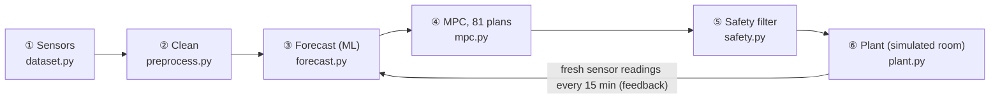

# Predictive Cooling Optimization for Data Centers

> **"If the load will rise in 30 minutes, how should we adjust the cooling right now so the racks stay below the limit and we use as little electricity as possible?"**

This version is a full redesign that follows the proposal: an ML forecast, MPC to choose a plan, a safety check, and a comparison against baselines.
It **drops everything that was not needed**: no LLM agents, LangGraph, Gemini, FastAPI, Supabase/auth or SustainDC install.
What is left is a small Python package with one file per step, a mock dataset you can open, and a dashboard with one tab per step.


## The idea in one minute



Every 15 minutes the system:

1. **Reads the sensors**: inlet temperature of 12 racks, IT and cooling power meters, CRAH status and outdoor weather.
2. **Cleans the data**: fills short gaps, removes impossible values and catches stuck sensors.
3. **Forecasts 15/30/45/60 minutes ahead**: if we use this setpoint plan, how hot will the hottest rack get, and how much cooling and IT power will we use?
4. **Lets the MPC try 81 plans**: each 15-minute step can lower, keep or raise the setpoint by 1 °C, four times (3⁴ = 81). Plans predicted to go above 27 °C are thrown out, the cheapest remaining plan wins, and only its first step is applied.
5. **Runs the safety filter**: every command is checked before it is sent. Missing sensors, conditions unlike the training data, or a rack near the limit override the AI immediately.
6. **Lets the plant judge**: the simulated room scores the result. Every controller faces the same workload, weather and sensor noise.

## Mock dataset: `data/sensor_history.csv`

A simulated 12-rack server room (two rows facing one shared cold aisle, CRAH units on the left wall), 2 Feb – 3 May 2026,
one reading every 15 minutes: **8,718 rows × 25 sensors** (about 1.6 MB, opens in Excel).


| Column | Unit | Meaning |
|---|---|---|
| `outdoor_temp_c` | °C | Outdoor air temperature (hot, humid Bangkok-like climate, warming toward April, afternoon storms) |
| `it_load_pct`, `it_power_kw` | %, kW | Average CPU/GPU load and server power (including the fans inside the servers) |
| `inlet_A1_c` … `inlet_B6_c` | °C | Air temperature at the front of each rack: **must stay at or below 27 °C** (ASHRAE) |
| `supply_air_c`, `return_air_c` | °C | Cold air leaving the CRAH units / hot air coming back |
| `crah_setpoint_c` | °C | **The one knob the AI controls**: supply-air setpoint (16–24 °C) |
| `crah_fan_pct` | % | CRAH fan speed (automatic, follows load) |
| `chiller_kw`, `crah_fan_kw`, `pump_tower_kw`, `cooling_kw` | kW | Cooling sub-meters |
| `facility_kw`, `pue` | kW, – | Whole-building power and PUE = facility ÷ IT |

How the data is made (`predictive_cooling/dataset.py`):

- **Workload**: office-hour demand, a **GPU training batch every weekday night 01:00–05:00** (racks B4–B6), an afternoon reporting job, and random unplanned jobs.
- **Plant**: `plant.py` is a simple physics model. Hot air recirculates (B6 at the end of the row is the hottest), the room has a thermal lag of about 25 minutes,
  the chiller COP improves by about 4 % per °C of higher setpoint, and server fans speed up when the inlet goes above 26 °C (so IT power rises).
- **Previous operator**: a simple rule ran the room and **occasionally ran setpoint step tests**, so the history contains many setpoint levels.
  (If the setpoint never changed, the model could not learn what the setpoint does.)
- **Real-world problems added on purpose**: 0.3 % missing values, glitch readings of 85/−40/0 °C, sensor A3 stuck for 8 hours, and 2 logger outages (18 rows).

Regenerate it with `python -m predictive_cooling.dataset` (seeds are fixed, so the result is identical every time).

## The steps in code

| Step | File | What it does |
|---|---|---|
| ① | `dataset.py` | Builds the workload, weather, operating history and log faults |
| ② | `preprocess.py` | Reindexes to the full 15-minute grid → removes impossible values → catches stuck sensors (same value ≥ 6 times) → fills holes up to 1 hour, then splits by time into train (weeks 1–9), validation (10–11) and test (12–13) |
| ③ | `forecast.py` | Compares 3 models: **Persistence** (baseline), **Linear** and **Gradient Boosting** with physics-based monotonic constraints (higher setpoint → warmer racks, less chiller power). One model per target × horizon (3 × 4) |
| ④ | `mpc.py` | Builds the 81 plans, forecasts each one, rejects plans where `forecast + safety margin > 27 °C`, and picks the plan with the lowest cooling + IT energy. The margin is the 99th percentile of how much the model under-predicted on the validation weeks |
| ④ | `controllers.py` | Fixed / Rule-based / AI, plus **feedback correction**: the last forecast error is added to the next forecast (helps when the room drifts away from the training data) |
| ⑤ | `safety.py` | R1 missing sensor → fallback, R2 unfamiliar conditions → fallback, R3 near the limit → cool by 2 °C now, R4 at most ±1 °C per 15 minutes and within 16–24 °C (fallback = the previous fixed setpoint, proven safe) |
| ⑥ | `plant.py`, `evaluate.py` | The simulated room is the judge: 14-day closed-loop runs in 4 scenarios |
| | `pipeline.py` | Runs every step end to end and tunes the baselines on validation (fixed = highest setpoint that never overheated, rule = lowest-energy deadband that never overheated) |
| | `app.py` | Dashboard with 6 tabs, one per step |

## Results (2 test weeks the model never saw)

### ③ Forecast accuracy

| Model | Inlet MAE 15 min | 30 min | 45 min | 60 min | Cooling NRMSE 60 min |
|---|---|---|---|---|---|
| Persistence (no AI) | 0.31 °C | 0.48 | 0.61 | 0.71 | 10.0 % |
| Linear regression | 0.19 °C | 0.25 | 0.30 | 0.34 | 7.0 % |
| **Gradient boosting** | **0.17 °C** | **0.17** | **0.18** | **0.18** | **3.5 %** |

This meets the proposal targets (MAE ≤ 1 °C at 15 minutes, NRMSE ≤ 10 %). Persistence is always late: it only notices the GPU batch after it has started.
The ML model learned from history that the batch starts at 01:00 on weekdays, so it sees it coming.


### ④ How the MPC chooses

Example at 00:30, just before the GPU batch: 18 of the 81 plans are safe, and the cheapest is 21 → 21 → 21 → 22 °C.
It lowers the setpoint by 1 °C first to pre-cool for the 01:00 job.


### ⑥ Controllers compared (normal operation, 14 days)

| | Fixed 20 °C | Rule-based (tuned) | **AI + MPC** |
|---|---|---|---|
| Cooling energy | 12,512 kWh | 12,144 kWh | **11,892 kWh** |
| Facility energy (incl. the 0.2 kW AI server running 24/7) | 44,687 kWh | 44,319 kWh | **44,141 kWh** |
| PUE | 1.489 | 1.477 | **1.471** |
| Minutes with inlet > 27 °C | 0 | 0 | **0** |
| Average setpoint | 20.0 °C | 21.4 °C | 22.4 °C |
| Decision time per step | – | – | 24 ms (target < 10 s) |

**Summary:** the AI cuts cooling energy by **5.0 %** vs the fixed setpoint and **2.1 %** vs the tuned rule-based controller.
Whole-building energy drops by 1.22 % / 0.40 % (about 57,000 / 18,500 THB per year at 4 THB/kWh), with no overheating at any point.


> **An honest reading:** the proposal targeted ≥ 10 % cooling savings vs a tuned rule-based controller. In this simulated room the AI **falls short at 2.1 %** because:
> (1) rack B6 is a hot spot and the hottest rack 100 % of the time, which caps how warm the room can run;
> (2) inlets above 26 °C make the server fans speed up, so warmer is not always cheaper (the model knows this and stops);
> (3) the setpoint is the only control knob.
> Next steps: fix the airflow at B6 (blanking panels/containment) or add knobs such as chilled-water temperature and fan speed.

### ⑤ Fault tests (minutes with inlet > 27 °C)

| Scenario | Fixed | Rule-based | AI + MPC | AI without safety filter |
|---|---|---|---|---|
| Normal | 0 | 0 | 0 | – |
| **B5/B6 sensors go offline** during the GPU batch | 0 | 210 | **0** (28 fallback steps) | 240 |
| **Room changed after training** (+20 % recirculation, chiller 10 % worse) | 1,980 | 150 | **60** | – |
| **Unplanned load surge** (+45–50 % on the GPU racks) | 0 | 0 | 15 (peak 27.03 °C) | – |

- The safety filter matters: without it, the AI trusts the remaining (cooler) sensors and lets the room overheat for 240 minutes.
- When the room changes, feedback correction cuts overheating from 240 to 60 minutes, but short exceedances remain when the batch starts. That is a signal to retrain.
- Nobody can forecast a job that has never happened before. The AI runs closer to the limit, so it is hit harder in the first 15 minutes; then R3 cools by 2 °C immediately.

## How to run

Requires Python 3.11+ (tested on 3.12).

```bash
python3 -m venv .venv
```

```bash
.venv/bin/pip install -r requirements.txt
```

```bash
.venv/bin/python -m predictive_cooling
```

The last command trains and tests everything (about 1–3 minutes, results cached in `artifacts/`) and then opens the dashboard at http://localhost:8501.
To run only the pipeline and print the result tables:

```bash
.venv/bin/python -m predictive_cooling.pipeline
```

Tests (15 tests, about 10 seconds):

```bash
.venv/bin/python -m pytest -q
```

## Dashboard (6 tabs = 6 steps)

1. **Sensors**: floor map (heatmap of the 12 racks) for any day and time, the whole day as charts, a column dictionary and a CSV download.
2. **Clean data**: the problems found in each sensor, raw vs cleaned, and the train/validation/test split.
3. **Forecast**: error by horizon, forecast vs actual, feature importance, and **a what-if where you set a setpoint plan and see what the model predicts**.
4. **MPC decision**: pick a time and see all 81 plans (energy vs peak temperature), which ones are safe and which one was chosen.
5. **Safety**: the 4 rules, how often each one fired, and a zoomed chart of each fault.
6. **Results**: energy, PUE, the proposal §8.4 style table, and the 3 controllers on the same day.

## Limitations

- All data is **mock** data from a simple physics model, not measurements from a real room. The numbers show *the method*, not guaranteed savings at a real site.
- The model and the plant were designed by the same person. Even though the forecaster never sees the equations, it should next be tested against another simulator (e.g. SustainDC) or real data.
- Nothing here controls real equipment. The system only recommends, in a simulated room.

## File layout

```
app.py                       Streamlit dashboard
data/sensor_history.csv      mock dataset (committed, open it directly)
predictive_cooling/
  config.py                  all constants (limit, horizon, split dates, electricity price)
  plant.py                   ⑥ simulated room (the judge)
  dataset.py                 ① builds the sensor history
  preprocess.py              ② cleaning + data split
  forecast.py                ③ forecasting models
  mpc.py                     ④ 81-plan MPC
  safety.py                  ⑤ safety filter
  controllers.py             Fixed / Rule-based / AI controllers
  evaluate.py                closed-loop tests + fault scenarios
  pipeline.py                runs everything + saves artifacts/
tests/test_pipeline.py       tests for every step
docs/                        README images
Midterm Project /            proposal report (PDF)
```

The previous version (agents/API/Supabase) is still in git history at commit `a817f29` and on the `main` branch.
