# Predictive Cooling Optimization for Data Centers

> **"If the load will rise in 30 minutes, how should we adjust the cooling right now so the racks stay below the limit and we use as little electricity as possible?"**

An **agent-based** system: three agents (Supervisor, Data Analyst, Cooling Advisor) answer an operator's question about the
room by calling guarded Python tools. The tools are the proposal's pipeline: sensor data → cleaning → ML forecast → 81-plan MPC →
safety filter, with a simulated room (plant) as the judge. The original agent architecture is kept: LangGraph, skills S1–S5,
guardrails G1/G2/G3, and offline or Gemini mode. What changed is what the agents work with. They now read **sensor data from the
data center**, use a **forecaster trained on a mock sensor dataset**, and choose a setpoint with **MPC**. Infrastructure that was
not needed for the idea (FastAPI, Supabase/auth, SustainDC install, CSV import) is removed.

## The idea in 30 seconds

| The problem | The idea | The result |
|---|---|---|
| Server rooms run their cooling at a safe but cold setpoint all day. Colder than needed = wasted electricity. | Every 15 minutes: **forecast the next hour**, try **81 setpoint plans**, keep only the ones that stay below 27 °C, and pick the cheapest. | **2.1 % less cooling energy** than a tuned rule-based controller (5.0 % vs a fixed setpoint), **0 minutes** above 27 °C. |

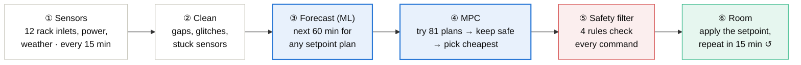

Blue = machine learning, red = safety, green = what reaches the room.

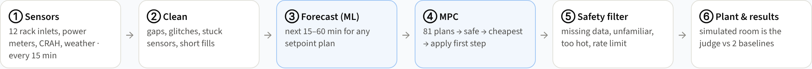

## Two layers

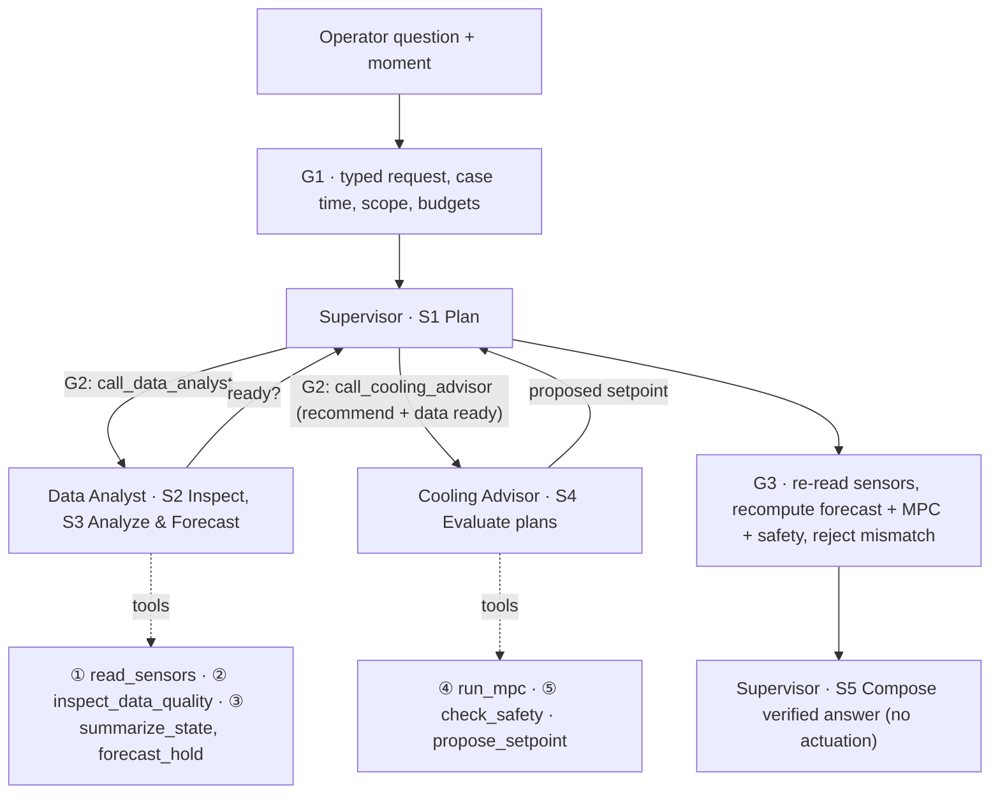

- **Agent layer (on demand)**: decides *what to check, in which order*, and explains. It cannot compute numbers itself, change
  the 27 °C limit, call tools outside its skill, or touch equipment.
- **Tool / control layer (every 15 min)**: the same Python steps also run the closed-loop controller that is scored on the plant.

| Role | Skills | Tools (allowlist enforced by G2) |
|---|---|---|
| Supervisor (parent) | S1 Plan, S5 Compose | `call_data_analyst`, `call_cooling_advisor`, `finish_case` |
| Data Analyst (child) | S2 Inspect, S3 Analyze & Forecast | `read_sensors`, `inspect_data_quality`, `summarize_state`, `forecast_hold`, `finish_analysis` |
| Cooling Advisor (child) | S4 Evaluate plans | `run_mpc`, `check_safety`, `propose_setpoint` |

| Guard | Where | Checks | Stops with |
|---|---|---|---|
| G1 | Before the graph | Pydantic request (15-min grid, known racks, question length), case time inside the log with 2 h history, budgets | `failed` |
| G2 | Every tool call and delegation | Skill owner + tool allowlist, phase (e.g. no MPC before inspection), shared tool/model budget, deadline. Tools only see readings **at or before** the case time | `TOOL_NOT_ALLOWED`, `budget_exceeded` |
| G3 | After the agents, before release | Re-reads the sensors, re-inspects quality, recomputes state, forecast, MPC and safety filter; proposal must equal the recomputed setpoint; range/rate limit; plan safe | `insufficient_data` (→ R1 fallback), `PROPOSAL_EVIDENCE_MISMATCH` |

**Modes.** *Offline*: LangGraph runs fixed role procedures, no LLM, deterministic. *Gemini*: real parent/child function
calling (separate histories, one tool per turn, phase-limited tool lists, shared budgets). Set `GEMINI_API_KEY` (and optionally
`GEMINI_MODEL`) to use it. Without a key the case fails closed. Live run (5 Nov 2026, `gemini-3.5-flash-lite`, case
21 Apr 00:30): 11 model calls, 36.8 s, G3 6/6 passed, same answer as offline (21 °C, plan 21 → 21 → 21 → 22). Gemini
cases get a 300 s deadline and retry 429/5xx errors. On a free key, prefer a flash-lite model: one case needs ~11
requests, the bigger flash models allow only ~20 requests per day, and `gemini-flash-latest` often answers 503
"high demand". The loops are also tested with a scripted provider, including a forged proposal that G3 must reject.

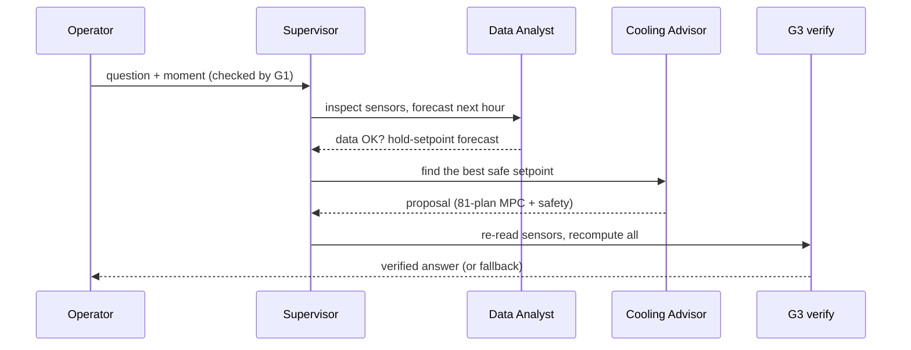

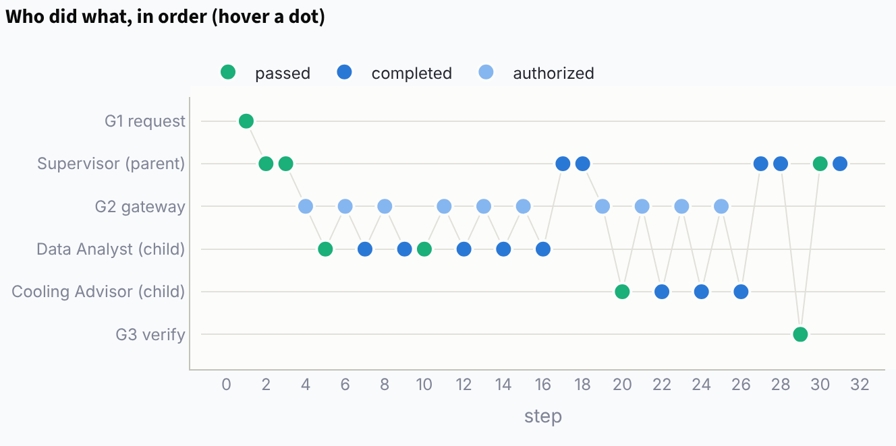

Example case (`python -m predictive_cooling.agents --at "2026-04-21 00:30"`): the Data Analyst finds that holding 22 °C would
reach 27.5 °C (incl. margin) when the 01:00 GPU batch starts. The Cooling Advisor finds 18 of 81 plans safe and proposes
21 °C (plan 21 → 21 → 21 → 22). G3 re-reads and recomputes, all 6 checks pass, and the answer is "Change from 22 °C to 21 °C now". With
`--fault B5 B6`, the data is not ready, the AI is withheld, and safety rule R1 moves toward the 20 °C fallback.

## Mock dataset: `data/sensor_history.csv`

A simulated 12-rack server room (two rows facing one shared cold aisle, CRAH units on the left wall), 2 Feb – 3 May 2026,
one reading every 15 minutes: **8,718 rows × 25 sensors** (about 1.6 MB, opens in Excel).

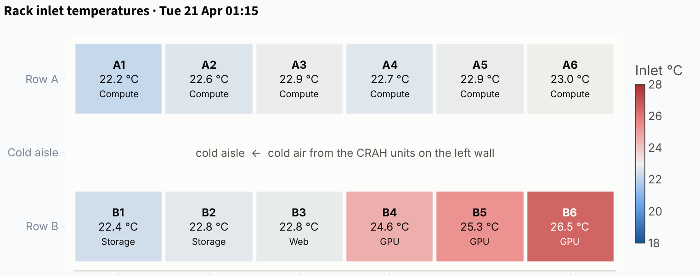

| Column | Unit | Meaning |
|---|---|---|
| `outdoor_temp_c` | °C | Outdoor air temperature (hot, humid Bangkok-like climate, warming toward April, afternoon storms) |
| `it_load_pct`, `it_power_kw` | %, kW | Average CPU/GPU load and server power (including the fans inside the servers) |
| `inlet_A1_c` … `inlet_B6_c` | °C | Air temperature at the front of each rack: **must stay at or below 27 °C** (ASHRAE) |
| `supply_air_c`, `return_air_c` | °C | Cold air leaving the CRAH units / hot air coming back |
| `crah_setpoint_c` | °C | **The one knob the AI controls**: supply-air setpoint (16–24 °C) |
| `crah_fan_pct` | % | CRAH fan speed (automatic, follows load) |
| `chiller_kw`, `crah_fan_kw`, `pump_tower_kw`, `cooling_kw` | kW | Cooling sub-meters |
| `facility_kw`, `pue` | kW, – | Whole-building power and PUE = facility ÷ IT |

How the data is made (`predictive_cooling/dataset.py`):

- **Workload**: office-hour demand, a **GPU training batch every weekday night 01:00–05:00** (racks B4–B6), an afternoon reporting job, and random unplanned jobs.
- **Plant**: `plant.py` is a simple physics model. Hot air recirculates (B6 at the end of the row is the hottest), the room has a thermal lag of about 25 minutes,
  the chiller COP improves by about 4 % per °C of higher setpoint, and server fans speed up when the inlet goes above 26 °C (so IT power rises).
- **Previous operator**: a simple rule ran the room and **occasionally ran setpoint step tests**, so the history contains many setpoint levels.
  (If the setpoint never changed, the model could not learn what the setpoint does.)
- **Real-world problems added on purpose**: 0.3 % missing values, glitch readings of 85/−40/0 °C, sensor A3 stuck for 8 hours, and 2 logger outages (18 rows).

Regenerate it with `python -m predictive_cooling.dataset` (seeds are fixed, so the result is identical every time).

Cleaning and the time-based split (never shuffle a time series: the model is scored on weeks it never saw):

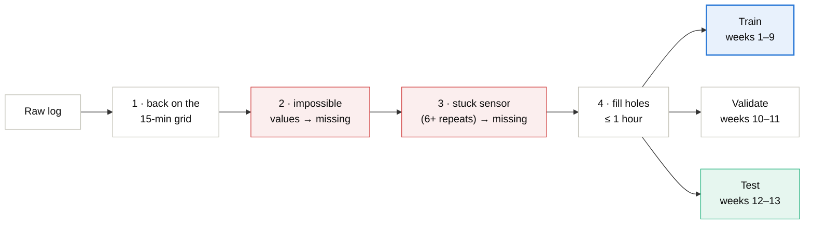

## The steps in code

| Step | File | What it does |
|---|---|---|
| ① | `dataset.py` | Builds the workload, weather, operating history and log faults |
| ② | `preprocess.py` | Reindexes to the full 15-minute grid → removes impossible values → catches stuck sensors (same value ≥ 6 times) → fills holes up to 1 hour, then splits by time into train (weeks 1–9), validation (10–11) and test (12–13) |
| ③ | `forecast.py` | Compares 3 models: **Persistence** (baseline), **Linear** and **Gradient Boosting** with physics-based monotonic constraints (higher setpoint → warmer racks, less chiller power). One model per target × horizon (3 × 4) |
| ④ | `mpc.py` | Builds the 81 plans, forecasts each one, rejects plans where `forecast + safety margin > 27 °C`, and picks the plan with the lowest cooling + IT energy. The margin is the 99th percentile of how much the model under-predicted on the validation weeks |
| ④ | `controllers.py` | Fixed / Rule-based / AI, plus **feedback correction**: the last forecast error is added to the next forecast (helps when the room drifts away from the training data) |
| ⑤ | `safety.py` | R1 missing sensor → fallback, R2 unfamiliar conditions → fallback, R3 near the limit → cool by 2 °C now, R4 at most ±1 °C per 15 minutes and within 16–24 °C (fallback = the previous fixed setpoint, proven safe) |
| ⑥ | `plant.py`, `evaluate.py` | The simulated room is the judge: 14-day closed-loop runs in 4 scenarios |
| | `pipeline.py` | Runs every step end to end and tunes the baselines on validation (fixed = highest setpoint that never overheated, rule = lowest-energy deadband that never overheated) |
| | `agents/` | Agent layer: `engine.py` (LangGraph, G1/G2/G3, S5), `tools.py` (the tools above), `gemini.py` (function-calling loops), `skills.py` + `skill_specs/` (S1–S5) |
| | `app.py` | Dashboard: “Ask the agents” tab + 6 tabs, one per step |

## Results (2 test weeks the model never saw)

### ③ Forecast accuracy

| Model | Inlet MAE 15 min | 30 min | 45 min | 60 min | Cooling NRMSE 60 min |
|---|---|---|---|---|---|
| Persistence (no AI) | 0.31 °C | 0.48 | 0.61 | 0.71 | 10.0 % |
| Linear regression | 0.19 °C | 0.25 | 0.30 | 0.34 | 7.0 % |
| **Gradient boosting** | **0.17 °C** | **0.17** | **0.18** | **0.18** | **3.5 %** |

This meets the proposal targets (MAE ≤ 1 °C at 15 minutes, NRMSE ≤ 10 %). Persistence is always late: it only notices the GPU batch after it has started.
The ML model learned from history that the batch starts at 01:00 on weekdays, so it sees it coming.

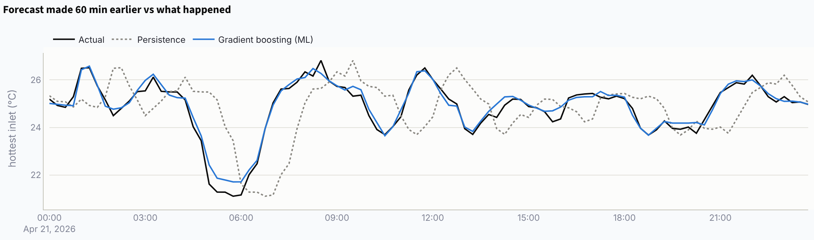

### ④ How the MPC chooses

Like a GPS: try every route for the next hour, drop the ones that overheat, take the cheapest, drive only the first
15 minutes, then plan again with fresh data.

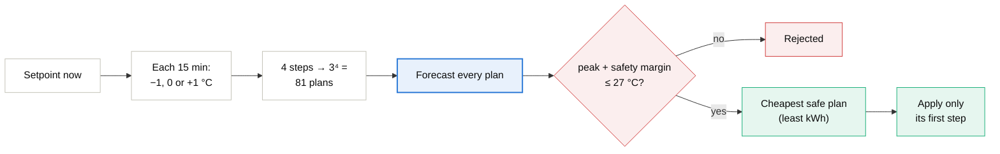

Example at 00:30, just before the GPU batch: 18 of the 81 plans are safe, and the cheapest is 21 → 21 → 21 → 22 °C.
It lowers the setpoint by 1 °C first to pre-cool for the 01:00 job.

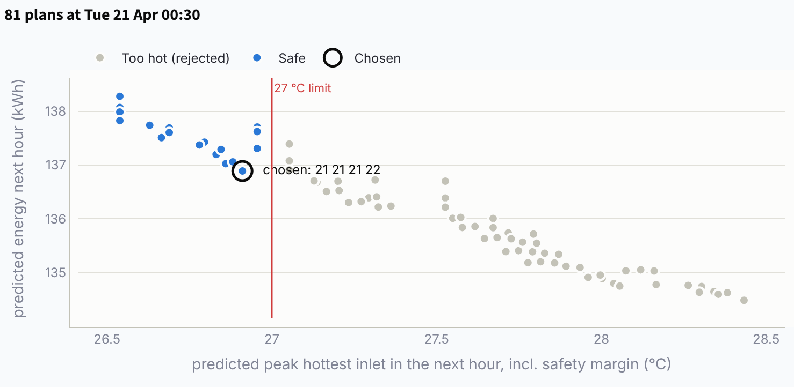

### ⑥ Controllers compared (normal operation, 14 days)

| | Fixed 20 °C | Rule-based (tuned) | **AI + MPC** |
|---|---|---|---|
| Cooling energy | 12,512 kWh | 12,144 kWh | **11,892 kWh** |
| Facility energy (incl. the 0.2 kW AI server running 24/7) | 44,687 kWh | 44,319 kWh | **44,141 kWh** |
| PUE | 1.489 | 1.477 | **1.471** |
| Minutes with inlet > 27 °C | 0 | 0 | **0** |
| Average setpoint | 20.0 °C | 21.4 °C | 22.4 °C |
| Decision time per step | – | – | 24 ms (target < 10 s) |

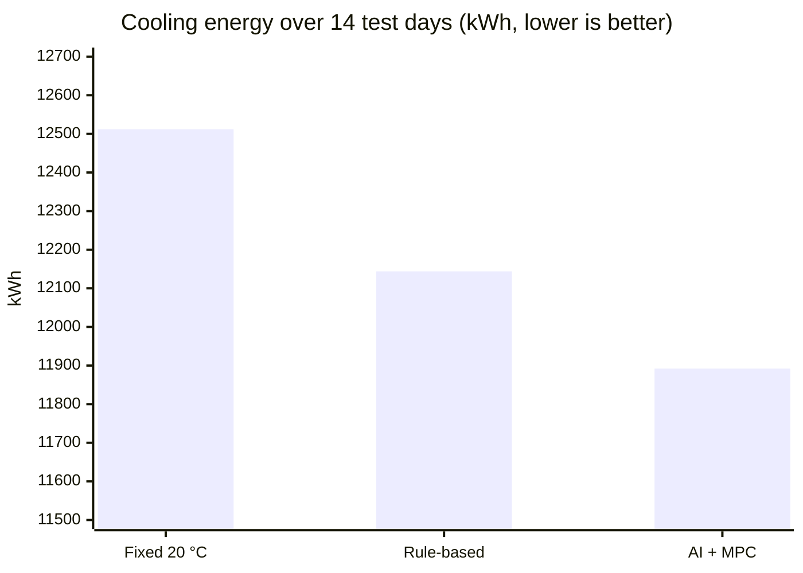

The axis starts at 11,500 kWh to make the gap visible; most cooling energy is needed whatever the setpoint.

**Summary:** the AI cuts cooling energy by **5.0 %** vs the fixed setpoint and **2.1 %** vs the tuned rule-based controller.
Whole-building energy drops by 1.22 % / 0.40 % (about 57,000 / 18,500 THB per year at 4 THB/kWh), with no overheating at any point.

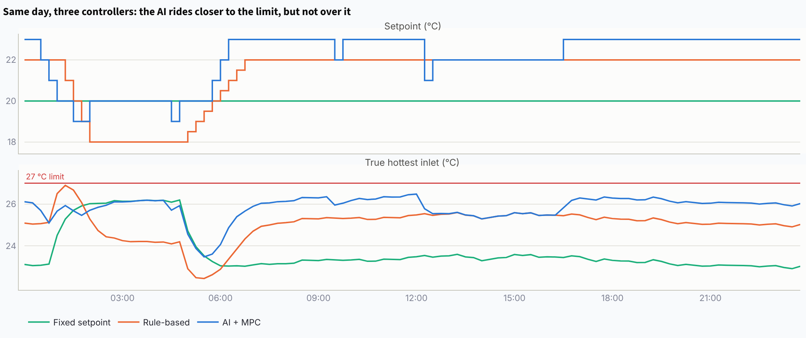

> **An honest reading:** the proposal targeted ≥ 10 % cooling savings vs a tuned rule-based controller. In this simulated room the AI **falls short at 2.1 %** because:
> (1) rack B6 is a hot spot and the hottest rack 100 % of the time, which caps how warm the room can run;
> (2) inlets above 26 °C make the server fans speed up, so warmer is not always cheaper (the model knows this and stops);
> (3) the setpoint is the only control knob.
> Next steps: fix the airflow at B6 (blanking panels/containment) or add knobs such as chilled-water temperature and fan speed.

### ⑤ Fault tests (minutes with inlet > 27 °C)

The AI only *proposes*; four rules can override it before anything is sent:

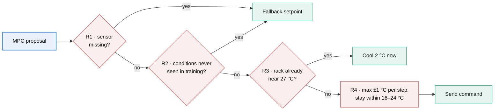

| Scenario | Fixed | Rule-based | AI + MPC | AI without safety filter |
|---|---|---|---|---|
| Normal | 0 | 0 | 0 | – |
| **B5/B6 sensors go offline** during the GPU batch | 0 | 210 | **0** (28 fallback steps) | 240 |
| **Room changed after training** (+20 % recirculation, chiller 10 % worse) | 1,980 | 150 | **60** | – |
| **Unplanned load surge** (+45–50 % on the GPU racks) | 0 | 0 | 15 (peak 27.03 °C) | – |

- The safety filter matters: without it, the AI trusts the remaining (cooler) sensors and lets the room overheat for 240 minutes.
- When the room changes, feedback correction cuts overheating from 240 to 60 minutes, but short exceedances remain when the batch starts. That is a signal to retrain.
- Nobody can forecast a job that has never happened before. The AI runs closer to the limit, so it is hit harder in the first 15 minutes; then R3 cools by 2 °C immediately.

## How to run

Requires Python 3.11+ (tested on 3.12). `requirements.txt` pins exact versions because the committed
`artifacts/bundle.pkl` is only reused when scikit-learn matches; otherwise the first start retrains (1–3 minutes).

```bash
python3 -m venv .venv
```

```bash
.venv/bin/pip install -r requirements.txt
```

```bash
.venv/bin/python -m predictive_cooling
```

The last command opens the dashboard at http://localhost:8501 (if `artifacts/bundle.pkl` is missing or was built with
another scikit-learn, it first trains and tests everything, about 1–3 minutes).
To run only the pipeline and print the result tables:

```bash
.venv/bin/python -m predictive_cooling.pipeline
```

Ask the agents from the command line:

```bash
.venv/bin/python -m predictive_cooling.agents --at "2026-04-21 00:30"
```

Tests (30 tests, about 40 seconds):

```bash
.venv/bin/python -m pytest -q
```

## Deploy

LangGraph is a Python library that runs inside the Streamlit process, so the whole app is **one Streamlit service**.
Gemini and Supabase are optional and switched on by secrets.

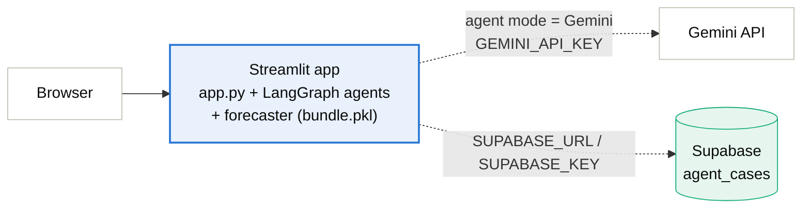

**Streamlit Community Cloud (free)**

1. Push this branch to GitHub (`artifacts/bundle.pkl` is committed so the app starts without retraining).
2. On [share.streamlit.io](https://share.streamlit.io) → *Create app* → pick the repo, branch `claude-new-version`, main file `app.py`.
   Under *Advanced settings* choose **Python 3.12**.
3. Paste your secrets (template: `.streamlit/secrets.toml.example`). Every key is optional:
   - `GEMINI_API_KEY` (from Google AI Studio) enables the *Gemini* agent mode; set `GEMINI_MODEL = "gemini-3.5-flash-lite"` on a free key.
   - `SUPABASE_URL` + `SUPABASE_KEY` enable the case history.

**Supabase case history (optional)**

1. Create a Supabase project and run `supabase/migrations/001_agent_cases.sql` in its SQL editor.
2. Put the project URL and the **server-side secret key** in the secrets. The key stays on the server (Streamlit code
   never runs in the browser); RLS is on and the public roles get no access to the table.
3. Every *Run case* in the agents tab is saved; *Case history (Supabase)* at the bottom of the tab shows the latest 20.
   If Supabase is down the case still runs and a toast says it was not saved.

For local runs, copy `.streamlit/secrets.toml.example` to `.streamlit/secrets.toml` (git-ignored) or export the same
names as environment variables.

## Dashboard

Every tab starts with an **In short** box (the message in plain language) and, where it helps, a diagram of the step.

0. **Ask the agents**: pick a moment, a task (recommend / analyze), optional failed sensors and the agent mode. You see the answer, a swimlane trace of who did what (G1 → Supervisor → G2 → Data Analyst → Cooling Advisor → G3), the G3 checklist, the forecast vs the chosen plan and (with Supabase) the case history.
1. **Sensors**: floor map (heatmap of the 12 racks) for any day and time, the whole day as charts, a column dictionary and a CSV download.
2. **Clean data**: the problems found in each sensor, raw vs cleaned, and the train/validation/test split.
3. **Forecast**: error by horizon, forecast vs actual, feature importance, and **a what-if where you set a setpoint plan and see what the model predicts**.
4. **MPC decision**: pick a time and see all 81 plans (energy vs peak temperature), which ones are safe and which one was chosen.
5. **Safety**: the 4 rules, how often each one fired, and a zoomed chart of each fault.
6. **Results**: energy, PUE, the proposal §8.4 style table, and the 3 controllers on the same day.

## Limitations

- All data is **mock** data from a simple physics model, not measurements from a real room. The numbers show *the method*, not guaranteed savings at a real site.
- The model and the plant were designed by the same person. Even though the forecaster never sees the equations, it should next be tested against another simulator (e.g. SustainDC) or real data.
- Nothing here controls real equipment. The system only recommends, in a simulated room.

## File layout

```
app.py                       Streamlit dashboard
data/sensor_history.csv      mock dataset (committed, open it directly)
predictive_cooling/
  config.py                  all constants (limit, horizon, split dates, electricity price)
  plant.py                   ⑥ simulated room (the judge)
  dataset.py                 ① builds the sensor history
  preprocess.py              ② cleaning + data split
  forecast.py                ③ forecasting models
  mpc.py                     ④ 81-plan MPC
  safety.py                  ⑤ safety filter
  controllers.py             Fixed / Rule-based / AI controllers
  evaluate.py                closed-loop tests + fault scenarios
  pipeline.py                runs everything + saves artifacts/
  storage.py                 optional Supabase case history
  agents/                    agent layer (Supervisor, Data Analyst, Cooling Advisor)
    engine.py                LangGraph graph, G1/G2/G3, S5 compose, run_case()
    tools.py                 the tools agents may call (window ends at the case time)
    gemini.py                Gemini parent/child function-calling loops
    skills.py, skill_specs/  S1–S5 registry and instructions
tests/test_pipeline.py       tests for every step
tests/test_agents.py         agent, guardrail and scripted-Gemini tests
tests/test_storage.py        Supabase history (off without keys, failures never break a case)
artifacts/bundle.pkl         trained models + test logs (committed for deployment)
supabase/migrations/         SQL for the optional agent_cases table
.streamlit/                  theme (config.toml) + secrets template
docs/                        README images
Midterm Project /            proposal report (PDF)
```

Branches: `main` = the earlier SustainDC/FastAPI/Supabase agent prototype; `claude` = the pipeline-only redesign (no agents); `claude-new-version` = this version (agent architecture + sensor data, trained forecaster and MPC).
